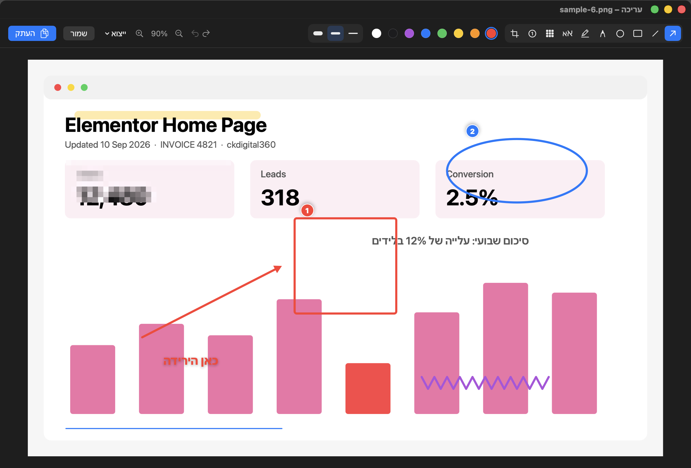
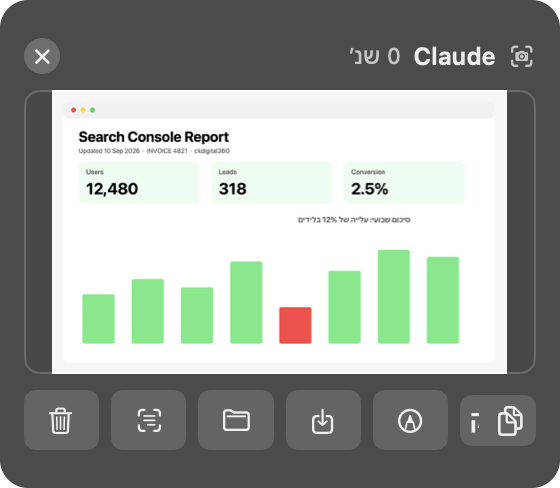
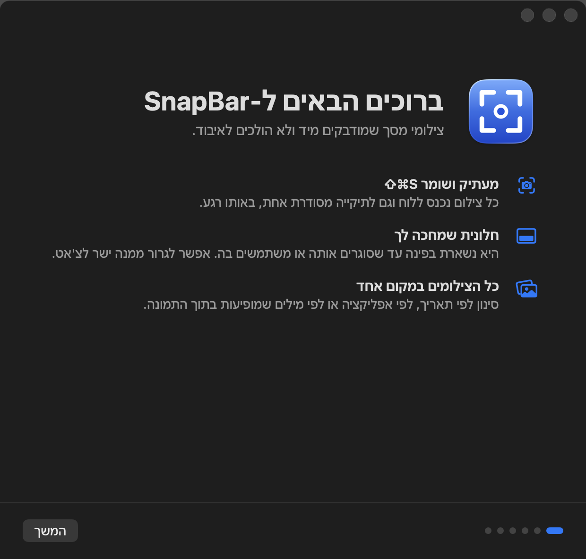

# SnapBar

**צילומי מסך במק שמודבקים מיד ולא הולכים לאיבוד.**
*Mac screenshots that paste right away and never get lost.*

macOS שומרת כל צילום מסך לקובץ בלבד, ולכן הדבקה מיד אחרי הצילום לא עובדת. התמונה הקטנה בפינה נעלמת אחרי חמש שניות, והצילומים מצטברים על שולחן העבודה. SnapBar פותרת את שלושת הדברים.

macOS saves every screenshot to a file only, so pasting right after a capture does nothing. The little corner preview disappears after five seconds, and screenshots pile up on the Desktop. SnapBar fixes all three.

---



---

## מה היא עושה · What it does

| | |
|---|---|
| **⇧⌘S** | צילום אזור. נכנס ללוח **וגם** נשמר כקובץ, באותו רגע. הדבקה עובדת מיד, בכל אפליקציה |
| **חלונית בפינה** | נשארת עד שסוגרים אותה או משתמשים בה. אפשר לגרור ממנה ישר לצ'אט או למייל. עד חמש נערמות |
| **ספרייה** | כל הצילומים במקום אחד, עם סינון לפי תאריך, לפי האפליקציה שממנה צולם, ולפי טקסט שמופיע בתוך התמונה |
| **עורך** | חץ, קו, מלבן, אליפסה, עט, מרקר, טקסט, טשטוש, מספור שלבים וחיתוך. ביטול בלי הגבלה |
| **⇧⌘4** | הקיצור המקורי של macOS ממשיך לעבוד, ו-SnapBar מעתיקה גם אותו ללוח |

הלוח תמיד מחזיק את הצילום האחרון. אם צילמת כמה במהירות, ההדבקה נותנת את האחרון, והשאר מחכים בספרייה.

| החלונית שנשארת | מסך הפתיחה |
|---|---|
|  |  |

---

## התקנה · Install

### הדרך הקצרה: להוריד את האפליקציה המוכנה

[SnapBar-1.0.0.dmg](https://github.com/korenzo12/SnapBar/releases/latest) · macOS 15 ומעלה

1. לפתוח את הקובץ ולגרור את SnapBar לתיקיית היישומים.
2. **בפתיחה הראשונה macOS תחסום את האפליקציה.** זה קורה לכל אפליקציה חינמית שאין לה תעודה
   בתשלום מאפל, וזה לא סימן שמשהו לא בסדר. הדרך לפתוח אותה בכל זאת:
   הגדרות המערכת ← פרטיות ואבטחה ← לגלול למטה ← **"פתח בכל זאת"**.
   בגרסאות macOS 15 ומעלה לחיצה ימנית ← פתח כבר לא עוקפת את החסימה, רק המסלול הזה.
3. לאשר הרשאת **הקלטת מסך** כשהיא מתבקשת, ואז לצאת מהאפליקציה ולפתוח אותה שוב.
   בלי ההרשאה הזו הצילומים יוצאים ריקים.

הקיצור הראשי: `⇧⌘S` מצלם אזור, מעתיק ושומר באותו רגע. `⌃⇧V` פותח את כל הצילומים.

### הדרך הארוכה: לבנות מהקוד

דורש macOS 15 ומעלה, Xcode 26 ומעלה, ו-[XcodeGen](https://github.com/yonaskolb/XcodeGen).

```bash
brew install xcodegen
git clone <repo-url> snapbar && cd snapbar
./scripts/install.sh
```

הסקריפט בונה גרסת Release, מתקין ל-`/Applications/SnapBar.app` ומפעיל. גרסה קודמת עוברת לאשפה ולא נמחקת.

לפיתוח בתוך Xcode:

```bash
xcodegen generate && open SnapBar.xcodeproj
```

`SnapBar.xcodeproj` הוא תוצר של `project.yml`. עורכים את ה-yml, לא את הפרויקט.

---

## הרשאה שצריך לתת · Required permission

macOS מבקשת הרשאת **הקלטת מסך** מכל אפליקציה שמצלמת מסך. בלעדיה הצילומים יוצאים ריקים.

הגדרות המערכת ← פרטיות ואבטחה ← הקלטת מסך ← להדליק את SnapBar, ואז לצאת מהאפליקציה ולפתוח מחדש.

האפליקציה מבקשת את זה במסך הפתיחה ומראה את המצב בזמן אמת.

---

## קיצורים · Shortcuts

| קיצור | פעולה |
|---|---|
| ⇧⌘S | צילום אזור |
| ⌃⇧V | ספריית הצילומים |
| רווח | תצוגה מקדימה מהירה בספרייה |
| ⌘A | בחירת הכל בספרייה |
| ⌘Z / ⇧⌘Z | ביטול וביצוע חוזר בעורך |
| A R O P T B C | כלי העורך: חץ, מלבן, אליפסה, עט, טקסט, טשטוש, חיתוך |

כל הקיצורים ניתנים לשינוי בהגדרות.

---

## איפה הדברים נשמרים · Where files live

| מה | איפה |
|---|---|
| הצילומים | `~/Pictures/Screenshots` (ניתן לשינוי) |
| אינדקס הספרייה | `~/Library/Application Support/SnapBar/history.json` |
| יומן | `~/Library/Logs/SnapBar/snapbar.log` |

הצילומים נשארים קבצים רגילים. מחיקה מהספרייה מעבירה לאשפה ולא מוחקת לצמיתות.

---

## פרטיות · Privacy

שום דבר לא יוצא מהמחשב. אין שרת, אין חשבון, אין מעקב, ואין תלויות חיצוניות. זיהוי הטקסט בתוך התמונות רץ מקומית דרך Vision של אפל.

Nothing leaves your Mac. No server, no account, no analytics, no third party dependencies. Text recognition runs locally through Apple's Vision framework.

---

## פיתוח · Development

```bash
./scripts/build.sh                 # Debug + Release, logs in build/logs
CONFIGS=Debug ./scripts/build.sh   # Debug only
xcodebuild -project SnapBar.xcodeproj -scheme SnapBar -destination 'platform=macOS' test
python3 scripts/make-strings.py    # rebuild the Hebrew string catalog, fails if a string is untranslated
./scripts/make-icon.sh             # regenerate the app icon
```

בבנייה של Debug בלבד יש מערכת בדיקות שמריצה את האפליקציה מהטרמינל:

```bash
SNAPBAR_HOME=/tmp/snapbar-test ./build/DerivedData/Build/Products/Debug/SnapBar.app/Contents/MacOS/SnapBar &
./scripts/snapctl library          # open the library
./scripts/snapctl ingest /path/to/image.png "Safari"
./scripts/snapctl snapshot /tmp/shot
```

`SNAPBAR_HOME` מבודד את הספרייה, ההגדרות והיומן לתיקייה נפרדת, כך שבדיקות לא נוגעות בנתונים האמיתיים. הקוד הזה מקומפל רק ב-Debug ולא נכנס לגרסת Release.

---

## מבנה · Structure

```
SnapBar/
  App/        נקודת הכניסה, שורת התפריטים, קיצורים גלובליים, תפריט ראשי
  Capture/    הרצת screencapture, לוח, כלי תמונה, מעקב אחרי צילומי ⇧⌘4
  Core/       מודל הצילום, אינדקס, סינון, תמונות ממוזערות, זיהוי טקסט, הגדרות
  Panel/      החלונית בפינה
  Library/    חלון הספרייה
  Editor/     העורך והרינדור
  Settings/   הגדרות ומסך הפתיחה
SnapBarTests/ 53 בדיקות יחידה
scripts/      בנייה, התקנה, אייקון, תרגום, כלי בדיקה
```

---

## רישיון · License

MIT. ראו [LICENSE](LICENSE).

נבנה על ידי [CK Digital 360](https://ckdigital360.co.il) עם Claude Code.
